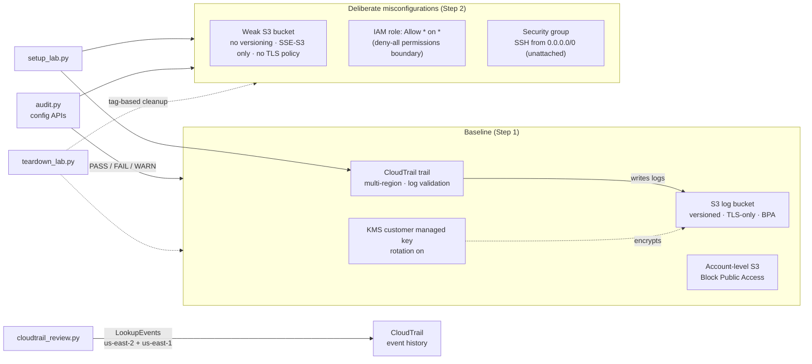

# AWS Cloud Security Lab

A hands-on lab in a single AWS sandbox account (us-east-2). It applies a
security baseline, deploys deliberately misconfigured resources, detects them
with Python/boto3 tooling, and reviews CloudTrail for risky activity. Every
control is then checked independently with the AWS CLI.

Everything is free-tier or near-free (about $1/month, for one KMS key). No EC2
instances, GuardDuty, Security Hub or AWS Config. All lab resources are tagged
`Project=SecurityLab`.

> Account IDs, key IDs, bucket suffixes, security group IDs and IP addresses in
> this repo are redacted (`111122223333`, `<key-id>`, `xxxxxxxx`, `x.x.x.x`).

## What this demonstrates

- **Secure-by-design audit logging.** A CloudTrail trail writes to an S3 bucket
  encrypted with a customer-managed KMS key. The key policy and bucket policy
  are both limited to the one trail (`aws:SourceArn`), which prevents the
  confused-deputy problem. Requests without TLS are denied, and log file
  validation provides tamper evidence.
- **Configuration auditing as code.** `audit.py` runs 20 checks across
  CloudTrail, S3, IAM and EC2, mapped to the CIS AWS Foundations Benchmark,
  with exit codes suitable for CI pipelines.
- **IAM policy analysis without managed tooling.** IAM Access Analyzer is
  blocked by an Organizations SCP, so IAM permission and trust policies are
  analysed directly.
- **Detection from audit logs.** `cloudtrail_review.py` scores risky actions
  from their request parameters (for example, SSH opened to `0.0.0.0/0`, or a
  policy granting `"*"` on `"*"`), not just their event names.
- **Evidence over assertions.** Each control was confirmed with independent
  CLI checks, and the analysers were tested on crafted inputs, including cases
  that must *not* be flagged. Real findings in the account were assessed rather
  than ignored.

## Architecture



## Repository layout

```
setup_lab.py            Build the baseline (Step 1) and misconfigurations (Step 2); safe to rerun
audit.py                Read-only security configuration audit (Step 3)
cloudtrail_review.py    Risky-activity review of CloudTrail event history (Step 4)
teardown_lab.py         Tag-based cleanup with dry run and confirmation (Step 5)
requirements.txt        boto3[crt]
docs/
  sample-audit-output.txt        Redacted audit.py report
  sample-cloudtrail-review.txt   Redacted cloudtrail_review.py report
```

## Quick start

Requirements: Python 3.12+, and AWS credentials with admin rights in a
**sandbox** account. Never run this in production: it deliberately creates
weak resources.

```
pip install -r requirements.txt     # boto3[crt]: the CRT extra is needed for `aws login` credentials
python setup_lab.py                 # build the lab (us-east-2 by default)
python audit.py                     # configuration audit
python cloudtrail_review.py         # risky-activity review (allow ~15 min for new events to appear)
python teardown_lab.py --dry-run    # preview cleanup, then run without --dry-run
```

## Cost

| Item | Cost |
|---|---|
| KMS customer managed key | about $1/month, prorated hourly |
| KMS requests | negligible; the S3 Bucket Key reduces calls from S3 to KMS |
| CloudTrail trail (management events) | free: the first copy of management events per region |
| S3 storage for logs | a few KB per day, a fraction of a cent |
| LookupEvents, IAM, security groups, Block Public Access | free |

No compute is created. After teardown, the KMS key stops being charged once its
deletion completes (7-day minimum waiting period).

## Step 1 — Baseline controls (`setup_lab.py`)

| Control | Implementation | Why |
|---|---|---|
| KMS customer managed key | `alias/seclab-cloudtrail`, annual rotation; key policy lets CloudTrail encrypt only for our trail (`aws:SourceArn`), decrypt only within this account | Customer-controlled key, separation of who can write vs. read logs |
| CloudTrail log bucket | Bucket-level Block Public Access, ACLs disabled (BucketOwnerEnforced), versioning, SSE-KMS default with S3 Bucket Key | Log integrity and confidentiality |
| Bucket policy | CloudTrail-only writes scoped to our trail; deny any request where `aws:SecureTransport` is false | Confused-deputy protection; encryption in transit |
| CloudTrail trail | `seclab-trail`: multi-region, global service events, log file validation, SSE-KMS | Complete, tamper-evident audit trail |
| Account S3 Block Public Access | All four settings on | Account-wide guardrail against public buckets |

IAM Access Analyzer is **not** used: an Organizations SCP on this managed
account explicitly denies `access-analyzer:*`. `audit.py` analyses IAM policies
directly instead.

## Step 2 — Deliberately misconfigured test resources

| Resource | Misconfiguration (what `audit.py` should flag) | Safety limit |
|---|---|---|
| `seclab-weak-bucket-xxxxxxxx` | No versioning, default SSE-S3 only (no customer-managed key), no TLS-only bucket policy | Still private: bucket and account Block Public Access |
| `SecLab-OverPrivilegedRole` | Inline policy `Allow` `Action: *` on `Resource: *` | Trust policy: own account only. Permissions boundary `SecLab-DenyAllBoundary` denies everything, so effective permissions are none |
| `seclab-open-ssh` security group | Ingress tcp/22 from `0.0.0.0/0` | Attached to no network interface |

S3 has encrypted every new bucket with SSE-S3 since January 2023, and that can't
be turned off. A truly unencrypted bucket is therefore no longer possible; the
realistic finding today is "no customer-managed KMS key".

```
python setup_lab.py                   # both steps (default: --step all)
python setup_lab.py --step baseline   # Step 1 only
python setup_lab.py --step misconfig  # Step 2 only
# options: --region us-east-2 (default), --profile NAME
```

## Step 3 — Security configuration audit (`audit.py`)

A read-only boto3 auditor. It only calls Describe/Get/List APIs, plus IAM's
credential-report generation, which changes nothing.

```
python audit.py                    # table report for us-east-2
python audit.py --json             # machine-readable findings
python audit.py --redact           # mask account IDs (for sharing output)
# options: --region, --profile, --no-color
# exit code: 1 if any FAIL, 2 if a check could not run (ERROR), else 0
```

| ID | Check | CIS AWS Foundations* |
|---|---|---|
| CT-1..6 | A multi-region trail is logging; global service events; log file validation; SSE-KMS | 3.1, 3.2, 3.5 |
| S3-1 | Account-level Block Public Access (all four settings) | 2.1.4 |
| S3-2 | Bucket-level Block Public Access | 2.1.4 |
| S3-3 | Versioning enabled | — |
| S3-4 | Default encryption uses KMS (SSE-S3 only = WARN) | — |
| S3-5 | Bucket policy denies requests where `aws:SecureTransport` is false | 2.1.1 |
| IAM-1 | Customer-managed and inline policies: `Allow *` on `*`, `NotAction` + Allow, `svc:*` on `*` (FAIL for iam/sts/kms/organizations/cloudtrail/account, WARN otherwise) | 1.16 |
| IAM-2 | `AdministratorAccess` / `IAMFullAccess` (FAIL) or `PowerUserAccess` (WARN) attached | 1.16 |
| IAM-3 | Role trust policies: `Principal "*"`, or external accounts without `sts:ExternalId` / `aws:PrincipalOrgID` | — |
| IAM-4, 5 | Root account has no access keys; root MFA enabled | 1.4, 1.5 |
| IAM-6, 7 | Console users without MFA; active access keys older than 90 days | 1.10, 1.14 |
| IAM-8 | Password policy present, minimum length ≥ 14 | 1.8 |
| EC2-1 | Security groups allowing SSH/RDP/all traffic from `0.0.0.0/0` or `::/0` (notes whether the group is attached) | 5.2, 5.3 |

\* Approximate mapping to CIS AWS Foundations Benchmark v3.0 numbering. Check it
against the benchmark version you use.

**Replacing IAM Access Analyzer.** An SCP blocks Access Analyzer in this
account, so IAM-1 to IAM-3 analyse the policy documents directly. One
`GetAccountAuthorizationDetails` call returns every user, group and role, with
inline policies, attached managed policies, trust policies and permissions
boundaries. IAM-3 covers the main external-access question Access Analyzer
answers for roles. Unlike Access Analyzer, it doesn't do formal reasoning about
conditions or check resource policies on other services.

**Errors are findings, not silent passes.** If an API call is denied (for
example by an SCP), that section reports `ERROR` instead of crashing or passing.

### Results against the lab

Full redacted output: [`docs/sample-audit-output.txt`](docs/sample-audit-output.txt)
(PASS 14, FAIL 6, WARN 4).

**All three deliberate misconfigurations were detected:**

| Planted weakness | Finding |
|---|---|
| Weak bucket: no versioning | `FAIL S3-3 Versioning: Never enabled` |
| Weak bucket: no customer-managed key | `WARN S3-4 Default encryption: AES256 (SSE-S3 only…)` |
| Weak bucket: no TLS-only policy | `FAIL S3-5 No bucket policy, so non-TLS requests are not denied` |
| Over-privileged role | `FAIL IAM-1 … Allow "Action": "*" on "Resource": "*" (full admin) [permissions boundary: SecLab-DenyAllBoundary…]` |
| Open SSH | `FAIL EC2-1 … Ingress SSH (22) from 0.0.0.0/0; not attached to anything` |

The role is still reported as a FAIL even though the boundary neutralises it.
The finding notes the boundary, because a boundary is a mitigation that can be
removed, not a fix for the policy itself.

**The audit also surfaced real findings in the managed sandbox account:**

| Finding | Assessment |
|---|---|
| `FAIL IAM-2 role/AccountFullAccessRole`: AdministratorAccess | This is the sandbox's admin role, the one used to build the lab. It's expected in a sandbox; in production you would scope it down or limit it with SCPs. |
| `WARN IAM-3` ×2: AWS-managed roles trust the Organizations management account without `sts:ExternalId` | Created by AWS Organizations account management; the trusted account is this organization's management account. Accepted risk: a cross-account trust inside the same organization. |
| `FAIL IAM-5`: root MFA not enabled | Root credentials in a managed member account are typically removed centrally by the organization. Verify with the account owner; if root has no password, this is an accepted exception. |
| `WARN IAM-8`: no password policy | No IAM users exist (access is via the sandbox role), so the risk is low; setting a policy is still good hygiene. |

## Step 4 — CloudTrail risky-activity review (`cloudtrail_review.py`)

Reviews recent management events with CloudTrail **LookupEvents**, the free
90-day event history. It works even without a trail.

```
python cloudtrail_review.py                     # last 24 hours
python cloudtrail_review.py --hours 168 --min-severity MEDIUM
python cloudtrail_review.py --json --redact
# options: --region, --profile, --max-scan N (default 5000 events per region)
# exit code: 1 if any HIGH finding, else 0
```

**How it works**

- **Two regions by default.** Event history is regional, and **IAM, STS and
  console sign-in events are recorded in us-east-1** whatever region you work
  in. The script reviews `--region` *and* us-east-1. Without this it would miss
  every IAM change the lab made.
- **Two passes per region:**
  1. Targeted `EventName` lookups for each of 31 risky actions, so none are missed.
  2. A capped scan of *all* events, to find root activity and repeated
     `AccessDenied` errors, which LookupEvents can't filter on. Truncation is
     reported, never silent.
- **Severity uses the request parameters, not just the event name:**

| Event | LOW / MEDIUM | Raised to HIGH when |
|---|---|---|
| `AuthorizeSecurityGroupIngress` | private CIDR (LOW); world on other ports (MEDIUM) | `0.0.0.0/0` or `::/0` on 22, 3389, or all traffic |
| `PutRolePolicy` / `PutUserPolicy` / `PutGroupPolicy` | any inline policy (MEDIUM) | policy grants `"*"` on `"*"` |
| `AttachRolePolicy` / `AttachUserPolicy` / `AttachGroupPolicy` | any managed policy (MEDIUM) | `AdministratorAccess` or `IAMFullAccess` |
| `CreatePolicyVersion` | MEDIUM | `"*"` on `"*"` and `setAsDefault` |
| `PutBucketPolicy` | MEDIUM | Allow to `Principal "*"` |
| `PutPublicAccessBlock` / `PutAccountPublicAccessBlock` | all on (LOW) | any setting turned off |
| `UpdateAssumeRolePolicy` | MEDIUM | trust allows `Principal "*"` |
| `ConsoleLogin` | federated/SSO (LOW); failure (MEDIUM) | root or IAM user without MFA |
| Always HIGH | | `StopLogging`, `DeleteTrail`, `DeleteFlowLogs`, `DisableKey`, `ScheduleKeyDeletion`, `Delete*PublicAccessBlock`, `CreateAccessKey`, `Delete*PermissionsBoundary`, any root activity |

Failed attempts are still reported, marked `[FAILED: <errorCode>]`. An
attempted `StopLogging` matters even if it was denied.

- **Rate limit.** LookupEvents allows about 2 requests per second; boto3's
  adaptive retry mode handles the throttling. A 24-hour review of this account
  (~930 events) takes about 30 seconds.

### Results against the lab

Full redacted output: [`docs/sample-cloudtrail-review.txt`](docs/sample-cloudtrail-review.txt)
(HIGH 4, MEDIUM 12, LOW 8).

**The lab build's own risky actions were found** (each twice, because `setup_lab.py` was run twice):

| Lab action | Finding |
|---|---|
| Open SSH rule | `HIGH AuthorizeSecurityGroupIngress sg-…: tcp/22 from 0.0.0.0/0`. The rerun's attempt shows `[FAILED: Client.InvalidPermission.Duplicate]` |
| `*:*` inline policy | `HIGH PutRolePolicy SecLab-OverPrivilegedRole: … grants "*" on "*"` (found in **us-east-1**) |
| Trail bucket policy, trail settings | `MEDIUM PutBucketPolicy`, `MEDIUM UpdateTrail` |
| Role and boundary creation | `LOW CreateRole`, `LOW CreatePolicy` (the rerun shows `EntityAlreadyExistsException`) |
| Account Block Public Access | `LOW PutAccountPublicAccessBlock account: all settings on` |

**Other activity in the account:**

| Finding | Assessment |
|---|---|
| `MEDIUM ConsoleLogin` ×2: failed sign-ins, user `HIDDEN_DUE_TO_SECURITY_REASONS` | AWS hides the username when it doesn't match an IAM user, so that a password typed into the username field is never logged. Confirm with the account owner that these were their own attempts. |
| `MEDIUM UpdateAssumeRolePolicy` ×3 via `account.amazonaws.com` | AWS Organizations account provisioning updating the managed roles that `audit.py` flagged in IAM-3. Expected. |
| `MEDIUM AccessDenied (aggregate)` | Calls blocked by the SCP (`ListAnalyzers`, the Access Analyzer probe made while planning this lab) plus console background calls. This is the SCP visibly working. |

## Step 5 — Cleanup (`teardown_lab.py`)

```
python teardown_lab.py --dry-run     # show what would be deleted; change nothing
python teardown_lab.py               # asks you to type DELETE
python teardown_lab.py --yes         # no prompt
python teardown_lab.py --keep-logs   # keep the CloudTrail bucket and its KMS key as evidence
```

**Safety design**

- **Only tagged resources.** Discovery uses the Resource Groups Tagging API
  (CloudTrail, S3, KMS, EC2) **plus IAM's own APIs**, because the tagging API
  doesn't cover IAM. Each resource's `Project=SecurityLab` tag is **checked again
  just before it is deleted**, so stale search results can't delete the wrong
  thing. Resource types the script doesn't handle are listed as `UNHANDLED`,
  not deleted.
- **Dependency order:**
  1. Stop logging and delete the trail.
  2. Empty each bucket, including every object version and delete marker.
  3. Delete the buckets.
  4. Remove the role's inline and attached policies and instance profiles, then delete the role.
  5. Delete the boundary policy (skipped if anything untagged still uses it).
  6. Delete the security group (skipped if attached to anything).
  7. Remove the KMS alias and **schedule the key for deletion in 7 days**, the
     minimum AWS allows. Cancel with `aws kms cancel-key-deletion` during that window.
- **`--keep-logs`** keeps the log bucket *and* its KMS key together. Logs whose
  key has been deleted can never be decrypted again.
- **Account-level S3 Block Public Access is left on.** It's an account
  guardrail, not a lab resource.
- Exit code 1 if any deletion fails or the prompt is declined.

## Verification

Each control was confirmed independently with the AWS CLI rather than by
trusting `setup_lab.py`'s own output.

### CloudTrail trail settings

```
$ aws cloudtrail get-trail --name seclab-trail \
    --query 'Trail.[IsMultiRegionTrail,IncludeGlobalServiceEvents,LogFileValidationEnabled,KmsKeyId]' --output text
True    True    True    arn:aws:kms:us-east-2:111122223333:key/<key-id>

$ aws cloudtrail get-trail-status --name seclab-trail --query IsLogging
true
```

### Log delivery and log file validation

Confirms CloudTrail can actually write through the bucket policy and KMS key
policy, and that digest files verify. Immediately after setup CloudTrail had
created both prefixes; the first log file arrived ~15 minutes later and the
first digest within the hour.

```
$ aws s3api list-objects-v2 --bucket seclab-cloudtrail-xxxxxxxx --query 'Contents[].Key' --output text
AWSLogs/111122223333/CloudTrail-Digest/    AWSLogs/111122223333/CloudTrail/

$ aws cloudtrail get-trail-status --name seclab-trail \
    --query '[LatestDeliveryTime,LatestDeliveryError,LatestDigestDeliveryTime]' --output text
2026-10-23T16:16:33-04:00    None    2026-10-23T16:13:07-04:00

$ aws cloudtrail validate-logs \
    --trail-arn arn:aws:cloudtrail:us-east-2:111122223333:trail/seclab-trail \
    --start-time 2026-10-23T19:30:00Z
Results found for 2026-10-23T19:30:00Z to 2026-10-23T19:45:14Z:
1/1 digest files valid
```

`LatestDeliveryError` is `None`, so both the bucket policy and the KMS key
policy allow CloudTrail to write. The first digest's signature verifies. That
digest covers a window that ended before the first log file was delivered, so
it references no log files yet; later digests also validate the SHA-256 hash of
each log file.

### Bucket encryption, versioning, Block Public Access

```
$ aws s3api get-bucket-encryption --bucket seclab-cloudtrail-xxxxxxxx \
    --query 'ServerSideEncryptionConfiguration.Rules[0]'
{
    "ApplyServerSideEncryptionByDefault": {
        "SSEAlgorithm": "aws:kms",
        "KMSMasterKeyID": "arn:aws:kms:us-east-2:111122223333:key/<key-id>"
    },
    "BucketKeyEnabled": true,
    "BlockedEncryptionTypes": { "EncryptionType": ["SSE-C"] }
}

$ aws s3api get-bucket-versioning --bucket seclab-cloudtrail-xxxxxxxx --output text
Enabled

$ aws s3api get-public-access-block --bucket seclab-cloudtrail-xxxxxxxx --output text
PUBLICACCESSBLOCKCONFIGURATION  True  True  True  True
```

### Non-TLS requests are denied

A plain-HTTP request from an admin principal is still refused — the explicit
`Deny` on `aws:SecureTransport = false` overrides any `Allow`.

```
$ aws s3api list-objects-v2 --bucket seclab-cloudtrail-xxxxxxxx \
    --endpoint-url http://s3.us-east-2.amazonaws.com
aws: [ERROR]: An error occurred (AccessDenied) when calling the ListObjectsV2 operation: User: arn:aws:sts::111122223333:assumed-role/... is not authorized ...
```

### KMS key rotation

(`get-key-rotation-status` does not accept an alias; use the key ID.)

```
$ aws kms get-key-rotation-status --key-id <key-id> \
    --query '[KeyRotationEnabled,RotationPeriodInDays]' --output text
True    365
```

### Account-level S3 Block Public Access

```
$ aws s3control get-public-access-block --account-id 111122223333 --output text
PUBLICACCESSBLOCKCONFIGURATION  True  True  True  True
```

### Step 2: weak bucket

```
$ aws s3api get-bucket-versioning --bucket seclab-weak-bucket-xxxxxxxx
                                    # empty output = versioning never enabled
$ aws s3api get-bucket-encryption --bucket seclab-weak-bucket-xxxxxxxx \
    --query 'ServerSideEncryptionConfiguration.Rules[0].ApplyServerSideEncryptionByDefault.SSEAlgorithm' --output text
AES256                              # SSE-S3 default, not KMS
$ aws s3api get-bucket-policy --bucket seclab-weak-bucket-xxxxxxxx
An error occurred (NoSuchBucketPolicy) ...   # no TLS-only policy
```

### Step 2: over-privileged role is neutered by its boundary

The IAM policy simulator evaluates the identity policy *and* the permissions
boundary. The inline policy allows everything, but the boundary's explicit deny
wins:

```
$ aws iam get-role-policy --role-name SecLab-OverPrivilegedRole \
    --policy-name SecLab-AllowEverything --query 'PolicyDocument.Statement'
[ { "Effect": "Allow", "Action": "*", "Resource": "*" } ]

$ aws iam get-role --role-name SecLab-OverPrivilegedRole \
    --query 'Role.[PermissionsBoundary.PermissionsBoundaryArn,AssumeRolePolicyDocument.Statement[0].Principal.AWS]' --output text
arn:aws:iam::111122223333:policy/SecLab-DenyAllBoundary    arn:aws:iam::111122223333:root

$ aws iam simulate-principal-policy \
    --policy-source-arn arn:aws:iam::111122223333:role/SecLab-OverPrivilegedRole \
    --action-names s3:ListAllMyBuckets iam:CreateUser ec2:RunInstances \
    --query 'EvaluationResults[].[EvalActionName,EvalDecision]' --output text
s3:ListAllMyBuckets    explicitDeny
iam:CreateUser         explicitDeny
ec2:RunInstances       explicitDeny
```

### Step 2: open-SSH security group is attached to nothing

```
$ aws ec2 describe-security-groups --group-ids sg-xxxxxxxx \
    --query 'SecurityGroups[0].IpPermissions[].[IpProtocol,FromPort,ToPort,IpRanges[0].CidrIp]' --output text
tcp    22    22    0.0.0.0/0

$ aws ec2 describe-network-interfaces --filters Name=group-id,Values=sg-xxxxxxxx \
    --query 'length(NetworkInterfaces)'
0
```

### Tagging

```
$ aws resourcegroupstaggingapi get-resources --tag-filters Key=Project,Values=SecurityLab \
    --query 'ResourceTagMappingList[].ResourceARN' --output text
arn:aws:s3:::seclab-cloudtrail-xxxxxxxx    arn:aws:s3:::seclab-weak-bucket-xxxxxxxx
arn:aws:kms:us-east-2:111122223333:key/<key-id>
arn:aws:cloudtrail:us-east-2:111122223333:trail/seclab-trail
arn:aws:ec2:us-east-2:111122223333:security-group/sg-xxxxxxxx
```

The IAM role and boundary policy are tagged too, but the Resource Groups
Tagging API doesn't cover IAM. Cleanup has to find them through IAM's own API.

### Step 3: auditor logic tested against crafted policies

Separately from the live account, the policy analysers were run on crafted
documents, including cases that must **not** be flagged:

```
perm  NotAction on *         -> FAIL  Allow with NotAction on all resources
perm  iam:* on *             -> FAIL  Allow "iam:*" on "Resource": "*"
perm  s3:* on *              -> WARN  Allow "s3:*" on "Resource": "*"
perm  s3:* scoped (ok)       -> (none)
perm  Deny * (ok)            -> (none)
perm  single stmt dict       -> FAIL  Allow "Action": "*" on "Resource": "*"
trust Principal *            -> FAIL  Trusts Principal "*" with no Condition
trust AWS * + condition      -> WARN  Trusts Principal "*" (restricted only by a Condition)
trust external no ExtId      -> WARN  Trusts external account ... with no sts:ExternalId ...
trust external w/ ExtId (ok) -> (none)
trust own account (ok)       -> (none)
trust service (ok)           -> (none)
```

`--json --redact` output was checked to contain no real account IDs. Your own
account becomes `111122223333` and each other account gets its own placeholder,
so cross-account findings still read correctly. The exit code was `1` (FAILs
present), as designed.

### Step 4: event analyser tested against crafted events

These cover attacks the lab didn't perform, including cases that must stay low:

```
StopLogging                    -> HIGH
PutBucketPolicy public         -> HIGH    b: Allow to Principal "*"
PutBucketPolicy private        -> MEDIUM
PutPublicAccessBlock off       -> HIGH    b: turned OFF BlockPublicAcls
AttachRolePolicy admin         -> HIGH    r: attached AdministratorAccess
AttachRolePolicy readonly      -> MEDIUM
CreatePolicyVersion */* dflt   -> HIGH    setAsDefault=True grants "*" on "*"
UpdateAssumeRolePolicy anyone  -> HIGH    trust policy allows Principal "*"
SG all traffic world           -> HIGH    all traffic from 0.0.0.0/0
SG 443 world                   -> MEDIUM  tcp/443 from 0.0.0.0/0
SG 22 private CIDR             -> LOW     no internet-wide rule
Console IAM user no MFA        -> HIGH    Console sign-in without MFA
Console SSO role               -> LOW     Console sign-in (federated/SSO)
CreateAccessKey failed         -> HIGH    [FAILED: AccessDenied]
```

### Step 5: teardown dry run and abort path

```
$ python teardown_lab.py --dry-run
==> Resources tagged Project=SecurityLab
    CloudTrail trail  arn:aws:cloudtrail:us-east-2:111122223333:trail/seclab-trail
    S3 bucket         seclab-cloudtrail-xxxxxxxx
    S3 bucket         seclab-weak-bucket-xxxxxxxx
    IAM role          SecLab-OverPrivilegedRole
    IAM policy        arn:aws:iam::111122223333:policy/SecLab-DenyAllBoundary
    Security group    sg-xxxxxxxxxxxxxxxxx
    KMS key           arn:aws:kms:us-east-2:111122223333:key/<key-id>
==> CloudTrail
    would stop logging and delete trail seclab-trail
==> S3 buckets
    would delete 40 object versions/delete markers, then bucket seclab-cloudtrail-xxxxxxxx
    would delete 0 object versions/delete markers, then bucket seclab-weak-bucket-xxxxxxxx
==> IAM roles
    would remove 1 inline / 0 attached policies, 0 instance profiles, then delete role SecLab-OverPrivilegedRole
==> IAM policies
    would delete policy SecLab-DenyAllBoundary (and its non-default versions)
==> Security groups
    would delete security group sg-xxxxxxxxxxxxxxxxx (seclab-open-ssh)
==> KMS keys
    would delete alias(es) alias/seclab-cloudtrail and schedule key <key-id> for deletion in 7 days
Dry run complete; nothing was changed.
```

All seven lab resources were found, including the two IAM resources that the
tagging API can't see. `--keep-logs` was dry-run too: it marked the log bucket
and KMS key `KEEP` and planned everything else. Answering anything other than
`DELETE` at the prompt printed `Aborted; nothing was changed.` and exited 1.
Afterwards the CLI confirmed every resource was untouched: the trail was still
logging, the role, security group and weak bucket still existed, and the key was
`Enabled`.

### Idempotency: `setup_lab.py` re-run

After each step the script was run again to prove it is safe to repeat: every
resource was found rather than duplicated, and settings were re-applied.

```
$ python setup_lab.py
    exists: alias/seclab-cloudtrail (<key-id>)
    exists: seclab-cloudtrail-xxxxxxxx
    exists, settings re-applied: seclab-trail
Baseline complete.
    exists: seclab-weak-bucket-xxxxxxxx
    exists: boundary policy SecLab-DenyAllBoundary
    exists: role SecLab-OverPrivilegedRole, boundary re-applied
    exists: seclab-open-ssh (sg-xxxxxxxx)
    ingress rule tcp/22 from 0.0.0.0/0 already present
Misconfigured test resources complete.
```

## Lessons learned

- **"Unencrypted S3 bucket" is no longer a valid test case.** S3 has applied
  SSE-S3 to every new bucket since January 2023. Today the meaningful questions
  are *whose key* (SSE-S3 or a customer-managed KMS key) and *in transit*
  (is there a TLS-only policy?).
- **IAM and sign-in events are recorded in us-east-1.** A CloudTrail review
  that only queries your working region misses every IAM change.
- **The Resource Groups Tagging API doesn't cover IAM.** Tag-based cleanup must
  query IAM separately, or roles and policies are silently left behind.
- **Managed accounts have guardrails you can't see from inside.** The SCP
  denying Access Analyzer could only be read from the management account. The
  tooling therefore reports what it couldn't check as `ERROR`, never as a
  silent PASS.
- **A permissions boundary is a mitigation, not a fix.** The IAM policy
  simulator showed the boundary blocking everything, yet the role is still
  reported as a FAIL: boundaries can be removed, and that removal
  (`DeleteRolePermissionsBoundary`) is itself flagged as HIGH by the review.
- **Small API details:** `kms get-key-rotation-status` rejects aliases; the
  first CloudTrail digest can precede the first log file; boto3 needs the `crt`
  extra to use `aws login` sessions.

## Limitations and next steps

- **Single account and region.** S3 and EC2 checks are limited to the chosen
  region. An organization-wide version would assume a read-only role in each
  member account.
- **IAM analysis is pattern-based.** It doesn't evaluate SCPs, conditions or
  resource-based policies on other services the way Access Analyzer's formal
  reasoning does.
- **LookupEvents covers management events only, for 90 days.** Data events
  (S3 object access) would need a trail with data event selectors (extra cost)
  and a query tool such as Athena.
- **CIS references are an approximate mapping** to CIS AWS Foundations v3.0
  numbering.
- **Teardown has so far been verified by dry run and the abort path only.** A
  full teardown-and-rebuild run is planned before the repo goes public.
- Possible extensions: a GitHub Actions workflow running `audit.py --json`
  through OIDC role federation; an EventBridge rule alerting on `StopLogging`
  in near real time.
